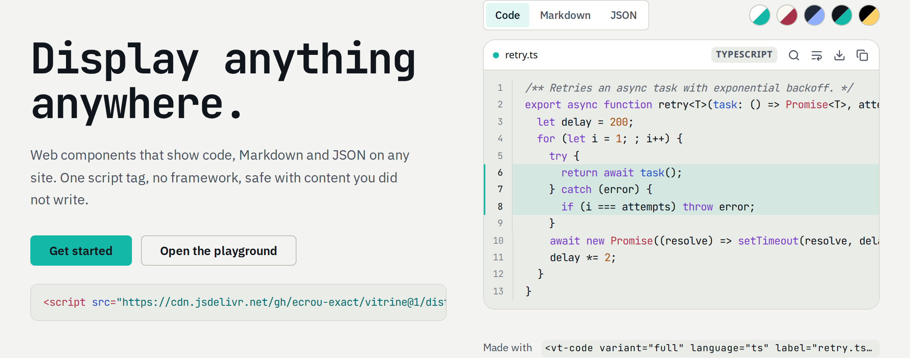

<p align="center">
  <picture>
    <source media="(prefers-color-scheme: dark)" srcset="brand/logo-horizontal-dark.svg">
    
  </picture>
</p>

<p align="center">
  Drop-in web components to display code, Markdown, JSON, CSV, tags, diffs, terminal sessions, file trees, HTTP exchanges, application logs, charts, OpenAPI descriptions, configuration files, hex dumps, timelines, jobs, Git histories, regular expressions, YAML, XML, TOML, JSON Web Tokens, cron schedules and X.509 certificates — on any website, with zero framework.
</p>

<p align="center">
  <a href="https://github.com/ecrou-exact/vitrine/actions/workflows/ci.yml"></a>
  <a href="LICENSE"></a>
  <a href="https://ecrou-exact.github.io/vitrine/"></a>
</p>

<p align="center">
  <a href="https://ecrou-exact.github.io/vitrine/">Website</a> &nbsp;|&nbsp;
  <a href="https://ecrou-exact.github.io/vitrine/examples.html">Examples</a> &nbsp;|&nbsp;
  <a href="https://ecrou-exact.github.io/vitrine/playground.html">Playground</a> &nbsp;|&nbsp;
  <a href="docs/getting-started.md">Documentation</a>
</p>

<picture>
  <source media="(prefers-color-scheme: dark)" srcset="docs/assets/preview-dark.png">
  
</picture>

> **Status:** pre-release. The components are implemented and tested; the API may still change before 1.0.

## Features

- **`<vt-code>`** — syntax highlighting for 190+ languages (common ones bundled, the rest loaded on demand), line numbers, highlighted lines, diffs, wrap, collapse, search, copy and download.
- **`<vt-markdown>`** — sanitized GitHub Flavored Markdown, Preview / Source / Split tabs, table of contents, heading anchors, image and link policies.
- **`<vt-json>`** — pretty printing or a collapsible tree, JSONPath copy, search inside collapsed nodes, exact big numbers, precise syntax errors.
- **`<vt-csv>`** — CSV and TSV as an accessible table with typed sorting, pagination and search.
- **`<vt-tags>`** — tags as chips, or a form field with suggestions, #hashtags, a browse panel and backend suggestions.
- **`<vt-diff>`** — two texts or a unified patch, side by side or unified, with changed words marked and arrows between changes.
- **`<vt-terminal>`** — terminal sessions with prompts, ANSI colors and styles, a copy button per command, collapsible output and a typing replay.
- **`<vt-tree>`** — file trees from `tree` output, indented text, paths or JSON, with icons, notes, change markers, links to files and keyboard navigation.
- **`<vt-http>`** — HTTP requests and responses from raw HTTP, curl commands, JSON or HAR, with code for curl, `fetch`, Python `requests` and HTTPie, and masked credentials.
- **`<vt-log>`** — application logs in plain text, JSON lines or logfmt, with levels, fields, stack traces kept with their entry, level buttons, a search that filters entries, and live streaming with `write()`.
- **`<vt-chart>`** — line, area, bar and donut charts from CSV or JSON, drawn with Apache ECharts (loaded on demand) in the theme colors, with keyboard reading of values and a Table view.
- **`<vt-openapi>`** — API references from OpenAPI 3.0 and 3.1 (or Swagger 2.0) descriptions in JSON or YAML: endpoints by tag, parameters, schema trees and generated examples.
- **`<vt-env>`** — dotenv, INI and `.properties` files as a table, with `${VAR}` references linked and secrets masked until revealed.
- **`<vt-hex>`** — hex dumps of binary data from `src`, hex or base64, with offsets, an ASCII column, bytes colored by kind, byte search and the file type read from its magic bytes.
- **`<vt-timeline>`** — incident timelines and release history from JSON or a Keep a Changelog file, grouped by date, with durations, kind filters and search.
- **`<vt-job>`** — jobs and CI runs with a progress bar, steps with status and duration, the log of each step with ANSI colors, and live updates with `setStep()` and `appendLog()`.
- **`<vt-git>`** — commit history as a graph of branches and merges from `git log` output or JSON, with branch and tag labels, branch filters, commit details and keyboard navigation.
- **`<vt-regex>`** — regular expressions colored by part and explained in words, matches and groups highlighted in a test text, a match table, replacement, and limits against catastrophic patterns.
- **`<vt-yaml>`** — YAML as a tree like `<vt-json>`, with several documents, anchors, aliases and merge keys, a highlighted raw view and copy as JSON (js-yaml loaded on demand).
- **`<vt-xml>`** — XML as a tree of elements, attributes, text, CDATA, comments and namespaces, with XPath copy and an indented raw view; read with its own parser, entities never expanded and nothing fetched.
- **`<vt-toml>`** — TOML 1.0 as a typed tree (dates, times, integers as written), with errors at their line and column, and copy as JSON.
- **`<vt-jwt>`** — JSON Web Tokens decoded: parts colored, header and payload as trees, claims explained with dates, validity status and security warnings; never verified and never sent anywhere.
- **`<vt-cron>`** — cron expressions and crontabs explained in words, with the next runs in a time zone, a week grid, Quartz extensions and errors at their field.
- **`<vt-cert>`** — X.509 certificates, chains and CSRs from PEM or DER with a bounded DER reader: names, validity, keys, extensions, fingerprints and an ASN.1 view; nothing verified or fetched.
- **Simple and full variants**, and every feature can be switched on or off with one attribute.
- **Secure by default** — sanitized output, no `eval`, size, depth and time limits, strict CSP and Trusted Types support. Tested against an XSS payload suite in three browsers.
- **Themable** — five built-in themes (all WCAG AA), CSS custom properties, `::part()` selectors and custom themes.
- **Accessible** — keyboard tabs and trees, labelled controls, screen reader announcements, reduced motion.
- **Works everywhere** — plain HTML, PHP, WordPress, Django, Vue, React, Svelte, Angular. Consumers never need Node.js.

## Quick start

### CDN (classic script)

```html
<script src="https://cdn.jsdelivr.net/gh/ecrou-exact/vitrine@1/dist/vitrine.min.js"
        integrity="sha384-…" crossorigin="anonymous"></script>

<vt-code language="python" line-numbers>
def hello(name):
    return f"Hello {name}"
</vt-code>
```

The exact `integrity` value of each release is published in its [release notes](https://github.com/ecrou-exact/vitrine/releases).

### ES module

```html
<script type="module">
  import { defineAll } from 'https://cdn.jsdelivr.net/gh/ecrou-exact/vitrine@1/dist/vitrine.esm.js';
  defineAll();
</script>
```

### Git submodule

```bash
git submodule add https://github.com/ecrou-exact/vitrine.git vendor/vitrine
cd vendor/vitrine && git checkout v1.0.0   # release tags contain the built dist/ folder
```

```html
<script src="/vendor/vitrine/dist/vitrine.min.js"></script>
```

### Untrusted content

Content written inside the element is parsed by the browser as part of your page, before Vitrine runs. **For data you did not write, always use the `content` property** (or `data` on `<vt-json>` and `<vt-tree>`, `exchange` on `<vt-http>`):

```js
document.querySelector('vt-markdown').content = commentFromUser;
```

## Components

| Element         | Simple variant                                      | Full variant adds                                                                                       | Reference                                                  |
| --------------- | --------------------------------------------------- | ------------------------------------------------------------------------------------------------------- | ---------------------------------------------------------- |
| `<vt-code>`     | Highlighted block                                   | Title bar, line numbers, search, wrap toggle, download, copy                                            | [docs/components/code.md](docs/components/code.md)         |
| `<vt-markdown>` | Rendered, sanitized Markdown                        | Preview / Source / Split tabs, TOC, anchors, search, copy                                               | [docs/components/markdown.md](docs/components/markdown.md) |
| `<vt-json>`     | Pretty-printed JSON                                 | Tree / Raw tabs, types, expand / collapse all, JSONPath bar, search                                     | [docs/components/json.md](docs/components/json.md)         |
| `<vt-csv>`      | Table with typed columns                            | Table / Raw tabs, sorting, row numbers, search, download, copy                                          | [docs/components/csv.md](docs/components/csv.md)           |
| `<vt-tags>`     | Tags as chips                                       | Tag field, suggestions, browse panel, form value                                                        | [docs/components/tags.md](docs/components/tags.md)         |
| `<vt-diff>`     | Unified comparison                                  | Side by side / Unified tabs, change arrows, search, copy patch                                          | [docs/components/diff.md](docs/components/diff.md)         |
| `<vt-terminal>` | Session with colors and a copy button per command   | Title bar, copy all commands, search, download, full screen                                             | [docs/components/terminal.md](docs/components/terminal.md) |
| `<vt-tree>`     | File tree with icons and indentation guides         | Title bar with folder and file counts, expand / collapse all, selected path bar, search, copy, download | [docs/components/tree.md](docs/components/tree.md)         |
| `<vt-http>`     | Request and response, credentials masked            | Exchange / Code tabs, search, copy, download as `.http`                                                 | [docs/components/http.md](docs/components/http.md)         |
| `<vt-log>`      | Entries with times, levels, fields and stack traces | Title bar, level buttons with counts, search that filters entries, follow, line numbers, download, copy | [docs/components/log.md](docs/components/log.md)           |
| `<vt-chart>`    | Line, area, bar or donut chart in the theme colors  | Title bar, Chart / Table tabs, copy and download as CSV, full screen                                    | [docs/components/chart.md](docs/components/chart.md)       |
| `<vt-openapi>`  | API reference grouped by tag                        | Title bar with the API version, endpoint search, expand / collapse all, copy, download                  | [docs/components/openapi.md](docs/components/openapi.md)   |
| `<vt-env>`      | Config entries as a table, secrets masked           | Table / Raw tabs, search that filters entries, reveal secrets, copy, download                           | [docs/components/env.md](docs/components/env.md)           |
| `<vt-hex>`      | Hex dump with offsets and ASCII                     | Title bar with the file type, byte search, copy as hex or base64, download, full screen                 | [docs/components/hex.md](docs/components/hex.md)           |
| `<vt-timeline>` | Events grouped by date                              | Kind buttons with counts, search that filters events, order toggle, copy as JSON, download              | [docs/components/timeline.md](docs/components/timeline.md) |
| `<vt-job>`      | Job summary, progress bar and steps with logs       | Search across logs, expand / collapse all, copy and download the log, full screen                       | [docs/components/job.md](docs/components/job.md)           |
| `<vt-git>`      | Commit graph with lanes, branches and tags          | Branch buttons, commit search, commit details, copy, download                                           | [docs/components/git.md](docs/components/git.md)           |
| `<vt-regex>`    | Colored pattern, highlighted matches and groups     | Flag buttons, match table, explanation, copy pattern and matches, download                              | [docs/components/regex.md](docs/components/regex.md)       |
| `<vt-yaml>`     | YAML tree, several documents, anchors               | Tree / Raw tabs, search, expand / collapse, copy as JSON, download                                      | [docs/components/yaml.md](docs/components/yaml.md)         |
| `<vt-xml>`      | XML tree with attributes and namespaces             | Tree / Raw tabs, search, XPath copy, indent, download                                                   | [docs/components/xml.md](docs/components/xml.md)           |
| `<vt-toml>`     | Typed TOML tree                                     | Tree / Raw tabs, search, path copy, copy as JSON, download                                              | [docs/components/toml.md](docs/components/toml.md)         |
| `<vt-jwt>`      | Decoded token, claims and status                    | Copy header, payload or token, masked signature, full screen                                            | [docs/components/jwt.md](docs/components/jwt.md)           |
| `<vt-cron>`     | Schedule in words and next runs                     | Crontab table, search, week grid, copy, download                                                        | [docs/components/cron.md](docs/components/cron.md)         |
| `<vt-cert>`     | Certificate cards and chain                         | Details / ASN.1 tabs, search, fingerprints copy, copy PEM, download                                     | [docs/components/cert.md](docs/components/cert.md)         |

Shared attributes (`variant`, `theme`, `src`, `max-height`, `copy`, `search`, `label`, `lang-ui`…) are described in [docs/common-attributes.md](docs/common-attributes.md). The JavaScript API (`Vitrine.configure`, `Vitrine.render`, `registerTheme`, `registerLocale`) is in [docs/configuration.md](docs/configuration.md).

## Theming

```html
<vt-json theme="dim" src="/api/order.json"></vt-json>
```

```css
/* Override any token on the element or any ancestor. */
.docs vt-code {
  --vt-accent: #7c9cff;
  --vt-radius: 4px;
  --vt-font-mono: 'Fira Code', monospace;
}

vt-code::part(header) {
  border-bottom-width: 2px;
}
```

Built-in themes: `light`, `dark`, `dim`, `paper`, `high-contrast`, and `auto` (follows the system). See [docs/theming.md](docs/theming.md).

## Security

Markdown goes through marked and then DOMPurify with a strict allow-list; dangerous URL schemes are removed; external links get `rel="noopener noreferrer"`; images can be blocked or restricted to your origin. Code and JSON are rendered with DOM text APIs only. `src` is same-origin by default, size-limited and cancellable.

The library works under this policy, which the website itself uses:

```text
default-src 'self'; script-src 'self'; style-src 'self'; img-src 'self' data:;
require-trusted-types-for 'script'; trusted-types vitrine
```

Details and the threat model: [docs/security.md](docs/security.md). To report a vulnerability, see [SECURITY.md](SECURITY.md).

## Browser support

Last two versions of Chrome, Edge, Firefox and Safari. Internet Explorer is not supported.

## Using with frameworks

Vitrine elements are standard custom elements. In Vue, declare them as custom elements:

```js
vue({ template: { compilerOptions: { isCustomElement: (tag) => tag.startsWith('vt-') } } });
```

React 19+, Svelte and Angular (`CUSTOM_ELEMENTS_SCHEMA`) work directly. See [docs/frameworks.md](docs/frameworks.md).

## Contributing

See [CONTRIBUTING.md](CONTRIBUTING.md) and the [Code of Conduct](CODE_OF_CONDUCT.md). The visual rules are in [docs/DESIGN_SYSTEM.md](docs/DESIGN_SYSTEM.md) and the logo specification in [brand/LOGO.md](brand/LOGO.md).

## Credits and third-party licenses

| Component                                                    | License                               | Used for                    |
| ------------------------------------------------------------ | ------------------------------------- | --------------------------- |
| [highlight.js](https://github.com/highlightjs/highlight.js)  | BSD-3-Clause                          | Syntax highlighting         |
| [marked](https://github.com/markedjs/marked)                 | MIT                                   | Markdown parsing (GFM)      |
| [DOMPurify](https://github.com/cure53/DOMPurify)             | Apache-2.0 OR MPL-2.0                 | HTML sanitization           |
| [Lucide](https://lucide.dev)                                 | ISC (icons derived from Feather: MIT) | Interface icons             |
| [JetBrains Mono](https://github.com/JetBrains/JetBrainsMono) | SIL OFL 1.1                           | Website font, logo wordmark |
| [IBM Plex Sans](https://github.com/IBM/plex)                 | SIL OFL 1.1                           | Website font                |

Full license texts, with exact versions: [THIRD_PARTY_NOTICES.md](THIRD_PARTY_NOTICES.md).

## License

[MIT](LICENSE)
