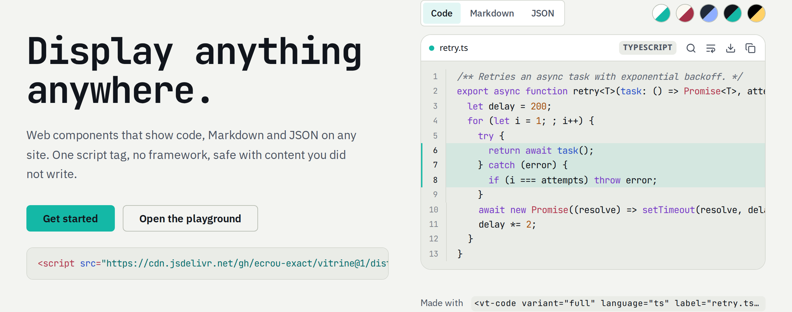

<p align="center">
  <picture>
    <source media="(prefers-color-scheme: dark)" srcset="brand/logo-horizontal-dark.svg">
    
  </picture>
</p>

<p align="center">
  Drop-in web components to display code, Markdown, JSON, CSV, tags, diffs, terminal sessions, file trees, HTTP exchanges, application logs, charts, OpenAPI descriptions, configuration files, hex dumps, timelines, jobs, Git histories, regular expressions, YAML, XML, TOML, JSON Web Tokens, cron schedules, X.509 certificates, service status pages, event calendars, pricing plans, FAQs, image galleries, key figures, task boards, form fields, site search, date pickers, menus, file uploads, testimonials, countdowns, SQL results, test reports, traces, Jupyter notebooks, math, diagrams, pivot tables, heat maps, flame graphs, treemaps, dataset profiles, dataset comparisons, install commands, download pages, contributors, support schedules, security advisories, dependency licenses, icon pickers, workflow runs, access logs, password fields, API key fields, version fields, cookie consent banners, changelogs, repository cards, indicators of compromise, CVSS scores, security headers, e-mail messages, DNS records, Nmap scans, URLs, hashes, network waterfalls, YARA rules, Sigma rules, packet captures, version ranges, color contrast, software bills of materials, Dockerfiles, Lighthouse reports and accessibility results — on any website, with zero framework.
</p>

<p align="center">
  <a href="https://github.com/ecrou-exact/vitrine/actions/workflows/ci.yml"></a>
  <a href="LICENSE"></a>
  <a href="https://ecrou-exact.github.io/vitrine/"></a>
</p>

<p align="center">
  <a href="https://ecrou-exact.github.io/vitrine/">Website</a> &nbsp;|&nbsp;
  <a href="https://ecrou-exact.github.io/vitrine/examples.html">Examples</a> &nbsp;|&nbsp;
  <a href="https://ecrou-exact.github.io/vitrine/playground.html">Playground</a> &nbsp;|&nbsp;
  <a href="docs/getting-started.md">Documentation</a>
</p>

<picture>
  <source media="(prefers-color-scheme: dark)" srcset="docs/assets/preview-dark.png">
  
</picture>

> **Status:** pre-release. The components are implemented and tested; the API may still change before 1.0.

## Features

- **`<vt-a11y>`** — accessibility results from axe-core or Pa11y: violations by impact with their WCAG criteria, the elements and what to fix, checks to review by hand, filters, CSV.
- **`<vt-access-log>`** — web server access logs (Apache, Nginx, IIS, Caddy, Traefik) as an analytics page: requests, visitors, errors, data and response times, requests over time, a table of requests with their IP, user and client, top lists, filters and anonymized IPs.
- **`<vt-advisories>`** — security reports from OSV, osv-scanner, `npm audit --json`, GitHub advisories or Dependabot: the most severe first, CVSS scores explained in words, affected versions and fixes.
- **`<vt-board>`** — a task board with real drag and drop (mouse, touch and keyboard), board, list and table views, tasks added and edited in place, filters, limits per column and cancelable events to save to your server. Read-only, it is a public roadmap.
- **`<vt-calendar>`** — events from iCalendar or JSON as a month grid or an agenda, with recurring events, time zones, keyboard navigation and Add to calendar.
- **`<vt-cert>`** — X.509 certificates, chains and CSRs from PEM or DER with a bounded DER reader: names, validity, keys, extensions, fingerprints and an ASN.1 view; nothing verified or fetched.
- **`<vt-changelog>`** — release notes from a `CHANGELOG.md` (Keep a Changelog, conventional-changelog), GitHub releases or JSON: versions with dates and badges, colored groups with breaking changes first, issues, mentions and commits linked, filters by kind, "what's new since" a version, links to each release and copy as Markdown.
- **`<vt-chart>`** — line, area, bar and donut charts from CSV or JSON, drawn with Apache ECharts (loaded on demand) in the theme colors, with keyboard reading of values and a Table view.
- **`<vt-code>`** — syntax highlighting for 190+ languages (common ones bundled, the rest loaded on demand), line numbers, highlighted lines, diffs, wrap, collapse, search, copy and download.
- **`<vt-compare>`** — the differences between two datasets: rows paired by a key, added, removed and changed, with the old and new value of each cell.
- **`<vt-consent>`** — a cookie consent banner as data protection authorities ask for it: refusing as easy as accepting, categories one by one, scripts and frames held back until accepted (`data-consent`), Google Consent Mode v2, Global Privacy Control, the choice asked again after a while or a change, a cookie for the server and a log of consents.
- **`<vt-contrast>`** — color contrast against WCAG 2.2: the ratio, AA and AAA for normal and large text and 3:1 for interface components, a preview, the nearest passing color, and a grid for a whole palette.
- **`<vt-contributors>`** — contributors and sponsors from GitHub, All Contributors, Open Collective or GitHub Sponsors: avatars, tiers and filters by type of contribution.
- **`<vt-countdown>`** — a countdown to a date in a time zone, in the words of the reader's language.
- **`<vt-cron>`** — cron expressions and crontabs explained in words, with the next runs in a time zone, a week grid, Quartz extensions and errors at their field.
- **`<vt-csv>`** — CSV and TSV as an accessible table with typed sorting, pagination and search.
- **`<vt-cvss>`** — CVSS vectors as a score, a severity in words and every metric explained: CVSS 3.0 and 3.1 scores computed (base, temporal, environmental), CVSS 4.0 explained, and a calculator with `editable`.
- **`<vt-date-picker>`** — a date or period field: typed in the order of the reader's language or chosen in an accessible calendar, usual periods such as "Last 7 days", blocked days, `min` / `max`, submitted in ISO 8601.
- **`<vt-describe>`** — the profile of a dataset, as pandas `describe()`: type, missing and distinct values, quartiles, histograms and most frequent values of each column.
- **`<vt-diagram>`** — Mermaid diagrams (loaded on demand, one type at a time) in the theme colors, sanitized again by Vitrine, under a strict CSP and Trusted Types.
- **`<vt-diff>`** — two texts or a unified patch, side by side or unified, with changed words marked and arrows between changes.
- **`<vt-dns>`** — DNS records from `dig` output, zone files or DNS-over-HTTPS JSON, with SPF, DMARC, DKIM, CAA, MX, SOA and SRV explained term by term and mail records checked (`+all`, too many lookups, `p=none`, short DKIM keys).
- **`<vt-dockerfile>`** — Dockerfiles as build stages: base images, copies between stages, user and ports of the final image, each instruction explained, and what linters flag (root, `latest`, secrets, caches, `curl | sh`).
- **`<vt-download>`** — a download page from a GitHub release: the file for the reader's system as one button, every other file with its size and SHA-256, and the command that checks it.
- **`<vt-email>`** — raw e-mail messages analyzed for phishing: SPF / DKIM / DMARC results, the Received path, the body as text, deceptive links, risky attachments with SHA-256, spoofed display names; nothing rendered or loaded.
- **`<vt-env>`** — dotenv, INI and `.properties` files as a table, with `${VAR}` references linked and secrets masked until revealed.
- **`<vt-faq>`** — questions and answers as an accordion, with a search, categories, links to a question and schema.org data for search engines.
- **`<vt-field>`** — a complete form field: required mark, "?" tip, hint, counter, clear errors, and lists with search, groups and several choices. It takes part in `<form>` like a native field.
- **`<vt-flame>`** — flame graphs of CPU profiles (folded stacks of perf, py-spy, async-profiler; Chrome and Node `.cpuprofile`), with zoom, search and the costliest functions.
- **`<vt-gallery>`** — images as a grid, with a viewer that moves with the keyboard and lazy loading without a referrer.
- **`<vt-git>`** — commit history as a graph of branches and merges from `git log` output or JSON, with branch and tag labels, branch filters, commit details and keyboard navigation.
- **`<vt-hash>`** — hashes of a text or a dropped file computed in the page: MD5, SHA-1, SHA-256, SHA-384 and SHA-512, as hex, base64 or SRI, compared with a fingerprint in any usual form (`sha256sum`, `sha384-…`, `sha256:…`).
- **`<vt-headers>`** — HTTP security headers checked from raw headers or `curl` output: a grade, each finding explained (HSTS, CSP, framing, cookies, CORS, version leaks), the Content-Security-Policy as a table; nothing fetched.
- **`<vt-heatmap>`** — heat maps: values by day as a calendar of weeks (contributions, activity), or by two categories as a matrix, with a scale, totals and a keyboard grid.
- **`<vt-hex>`** — hex dumps of binary data from `src`, hex or base64, with offsets, an ASCII column, bytes colored by kind, byte search and the file type read from its magic bytes.
- **`<vt-http>`** — HTTP requests and responses from raw HTTP, curl commands, JSON or HAR, with code for curl, `fetch`, Python `requests` and HTTPie, and masked credentials.
- **`<vt-icon-picker>`** — an icon field for forms: about 7,000 free icons (Font Awesome Free solid, regular and brands, Lucide, Bootstrap Icons, and every country flag), searched by name and keyword, chosen with the keyboard, each set loaded only when shown; copy the SVG or the class names.
- **`<vt-install>`** — an install command for every package manager: write `npm i -D vitrine` once and get pnpm, yarn, bun and deno (or pip, uv, poetry and pdm), as tabs shared by the page and remembered.
- **`<vt-ioc>`** — indicators of compromise found in any text (URLs, domains, IPs, e-mails, hashes, CVE, ATT&CK), defanged ones too: shown defanged and never linked, filtered by type, copied as a list, CSV, STIX 2.1 or a MISP event.
- **`<vt-job>`** — jobs and CI runs with a progress bar, steps with status and duration, the log of each step with ANSI colors, and live updates with `setStep()` and `appendLog()`.
- **`<vt-json>`** — pretty printing or a collapsible tree, JSONPath copy, search inside collapsed nodes, exact big numbers, precise syntax errors.
- **`<vt-jwt>`** — JSON Web Tokens decoded: parts colored, header and payload as trees, claims explained with dates, validity status and security warnings; never verified and never sent anywhere.
- **`<vt-licenses>`** — the licenses of your dependencies from a CycloneDX or SPDX SBOM, license-checker or pip-licenses: permissive or copyleft, and those not in your allowed list.
- **`<vt-lifecycle>`** — supported versions and their end of life, from endoflife.date or a list: a table and a schedule like Node.js's, and whether a given version is still supported.
- **`<vt-lighthouse>`** — Lighthouse and PageSpeed Insights reports: score gauges, Core Web Vitals of real users, lab metrics, opportunities with their savings, audits by category.
- **`<vt-log>`** — application logs in plain text, JSON lines or logfmt, with levels, fields, stack traces kept with their entry, level buttons, a search that filters entries, and live streaming with `write()`.
- **`<vt-markdown>`** — sanitized GitHub Flavored Markdown, Preview / Source / Split tabs, table of contents, heading anchors, image and link policies.
- **`<vt-math>`** — TeX drawn as native MathML (Temml, loaded on demand): equations, numbered or not, inline math in text, `$…$` delimiters and macros.
- **`<vt-menu>`** — a dropdown, "⋮" or right-click menu of actions: links, check boxes, radio groups, shortcuts, icons and submenus, with the full keyboard of WAI-ARIA, always inside the window.
- **`<vt-nmap>`** — Nmap results from XML, normal or grepable output: hosts with OS and MAC vendor, ports with state, service, version and script output, risky exposed services marked, copy as CSV.
- **`<vt-notebook>`** — Jupyter notebooks: Markdown cells, highlighted code with execution counts, and outputs (text with colors, images, pandas tables, errors), sanitized and never run; code can be hidden like a report.
- **`<vt-openapi>`** — API references from OpenAPI 3.0 and 3.1 (or Swagger 2.0) descriptions in JSON or YAML: endpoints by tag, parameters, schema trees and generated examples.
- **`<vt-password>`** — a password field that rates passwords as an attacker would guess them (common passwords, leet, keyboard runs, sequences, dates, the user's own name), says how long an attack would take and why, checks requirements as you type, generates strong passwords, confirms them and can check known data breaches with k-anonymity.
- **`<vt-pcap>`** — packet captures (pcap, pcapng) read in the page: packets with Ethernet, ARP, IP, ICMP, TCP, UDP, DNS, HTTP and TLS decoded, each field tied to its bytes, conversations, host names seen (DNS, TLS server names, HTTP Host), filters.
- **`<vt-pivot>`** — pivot tables from CSV or JSON: rows × columns, sum, count, average, min, max or distinct values, totals, shaded cells, lists to change the fields, and the records of a cell on a click.
- **`<vt-pricing>`** — pricing plans as cards, with a billing period switch, several currencies, savings worked out, a table comparing the plans and an event for your checkout.
- **`<vt-regex>`** — regular expressions colored by part and explained in words, matches and groups highlighted in a test text, a match table, replacement, and limits against catastrophic patterns.
- **`<vt-repo>`** — a repository card from the GitHub or GitLab API: stars, forks, issues and watchers, a language bar, license, latest release, last activity, topics and the clone command to copy.
- **`<vt-sbom>`** — software bills of materials (CycloneDX, SPDX): the dependency tree, components with license kinds and the path that brings them in, and the vulnerabilities of a VEX with the components they affect.
- **`<vt-search>`** — a site search for your menu: Ctrl K / ⌘ K / `/`, a JSON index or your API, typo-tolerant ranking, results by id (UUID) with `url-template`, recent searches, fully accessible.
- **`<vt-secret>`** — an API key field: the key blurred and not in the page until shown, copy without showing it or as a `.env` line, shell export or header, the service and kind of about thirty kinds of keys (live or test, secret or publishable), expiry, scopes, show once, auto-hide and regenerate.
- **`<vt-semver>`** — version ranges (`^1.2.3`, `~1.2`, `>=1.4 <2`, `1.x || 2.x`) explained in words, with the versions that match, the one installed and what to watch.
- **`<vt-sigma>`** — Sigma detection rules explained: level, ATT&CK and CVE tags as links, log source, searches with their modifiers in words, the condition as a tree, and what `sigma check` would flag.
- **`<vt-sql>`** — SQL queries, laid out on demand, and their results from a `psql`, `mysql`, `sqlite3` or DuckDB session or JSON (node-postgres results too): sortable tables, `NULL` told apart, row counts, timings and errors.
- **`<vt-stats>`** — key figures as tiles: values written for the reader's language, changes in words and a small history read with the keyboard.
- **`<vt-status>`** — service status pages from JSON or a Statuspage summary: overall state, uptime with a bar per day, incidents with their updates, scheduled maintenance and live refresh.
- **`<vt-table>`** — a complete data table: sorting on several columns, filters per column, selection with bulk actions, grouping, expandable rows, a column chooser, resizing, reordering and pinning, footer totals, cell editing, virtual scrolling, keyboard navigation and a card layout on phones.
- **`<vt-tags>`** — tags as chips, or a form field with suggestions, #hashtags, a browse panel and backend suggestions.
- **`<vt-terminal>`** — terminal sessions with prompts, ANSI colors and styles, a copy button per command, collapsible output and a typing replay.
- **`<vt-test-report>`** — test reports from JUnit XML, TAP or the JSON of Jest, Vitest and Mocha: counts, a bar, suites, failures with their stack traces and colors, status filters and "Copy failures".
- **`<vt-testimonials>`** — testimonials and reviews as a grid, a list or a carousel, with ratings and their average.
- **`<vt-timeline>`** — incident timelines and release history from JSON or a Keep a Changelog file, grouped by date, with durations, kind filters and search.
- **`<vt-toml>`** — TOML 1.0 as a typed tree (dates, times, integers as written), with errors at their line and column, and copy as JSON.
- **`<vt-trace>`** — distributed traces from OpenTelemetry (OTLP JSON), Jaeger or Zipkin as a waterfall of spans, with services, errors, a time ruler, keyboard navigation and the details of each span.
- **`<vt-tree>`** — file trees from `tree` output, indented text, paths or JSON, with icons, notes, change markers, links to files and keyboard navigation.
- **`<vt-treemap>`** — treemaps of sizes (esbuild metafiles, webpack stats, `du`, CSV, JSON trees): what takes the space in a bundle or a disk, with zoom, search and a list.
- **`<vt-upload>`** — a file field with a drop zone, thumbnails, reasons for refused files, and uploads with progress to your server.
- **`<vt-url>`** — URLs taken apart and checked: host before `@`, disguised IPs, homographs, deceptive subdomains, shorteners, URLs hidden in parameters (redirects, base64, Proofpoint), tracking parameters; defanged, never links.
- **`<vt-version>`** — a version field for Semantic Versioning, dotted numbers, CalVer or decimals: only valid characters, − and + and arrow keys per part, parts that carry (1.9 → 2.0), spin buttons per part, the next versions and the kind of release from the current one.
- **`<vt-waterfall>`** — HAR files (browsers, Playwright, Lookyloo) as a network waterfall: phases of each request, DOMContentLoaded and load, redirects before the page, third parties, mixed content, filters, domains.
- **`<vt-workflow>`** — a CI run as a CI system shows it: a graph of jobs linked by what they need, live statuses with times counting up, and each job's steps and logs with ANSI colors, folded groups and errors; from GitHub Actions, GitLab or your own JSON.
- **`<vt-xml>`** — XML as a tree of elements, attributes, text, CDATA, comments and namespaces, with XPath copy and an indented raw view; read with its own parser, entities never expanded and nothing fetched.
- **`<vt-yaml>`** — YAML as a tree like `<vt-json>`, with several documents, anchors, aliases and merge keys, a highlighted raw view and copy as JSON (js-yaml loaded on demand).
- **`<vt-yara>`** — YARA rules explained: strings (text, hex, regex) and what their modifiers do, the condition colored and read in words, undefined or unused strings, short atoms, missing imports.
- **JSON everywhere** — every element reads JSON from a `data` property, a `json` or `json-src` attribute (with `json-path`) or a JSON script, and turns it into its own format. See [docs/json.md](docs/json.md).
- **Simple and full variants**, and every feature can be switched on or off with one attribute.
- **Secure by default** — sanitized output, no `eval`, size, depth and time limits, strict CSP and Trusted Types support. Tested against an XSS payload suite in three browsers.
- **Themable** — five built-in themes (all WCAG AA), CSS custom properties, `::part()` selectors and custom themes.
- **Accessible** — keyboard tabs and trees, labelled controls, screen reader announcements, reduced motion.
- **Works everywhere** — plain HTML, PHP, WordPress, Django, Vue, React, Svelte, Angular. Consumers never need Node.js.

## Quick start

### Only the elements you use (loader)

```html
<script src="https://cdn.jsdelivr.net/gh/ecrou-exact/vitrine@0/dist/vitrine-loader.js"></script>

<vt-sql dialect="postgresql">SELECT * FROM users;</vt-sql>
```

A 1.2 KB script finds the elements of the page and loads only their modules. The [Integrations page](https://ecrou-exact.github.io/vitrine/integrations.html#pick) tells what a set of elements weighs.

### Every element (classic script)

```html
<script src="https://cdn.jsdelivr.net/gh/ecrou-exact/vitrine@0/dist/vitrine.min.js"
        integrity="sha384-…" crossorigin="anonymous"></script>

<vt-code language="python" line-numbers>
def hello(name):
    return f"Hello {name}"
</vt-code>
```

The exact `integrity` value of each release is published in its [release notes](https://github.com/ecrou-exact/vitrine/releases).

### npm and bundlers

```bash
npm install github:ecrou-exact/vitrine#vX.Y.Z   # release tags hold dist/
```

```js
import 'vitrine/code'; // defines <vt-code>: bundlers keep only what you import
import 'vitrine/sql';
```

Plugins for [markdown-it and remark](docs/frameworks.md#markdown-pipelines) turn fenced code blocks into elements: a `sql` block becomes `<vt-sql>`, a `mermaid` block `<vt-diagram>`.

### ES module

```html
<script type="module">
  import { defineAll } from 'https://cdn.jsdelivr.net/gh/ecrou-exact/vitrine@0/dist/vitrine.esm.js';
  defineAll();
</script>
```

### Git submodule

```bash
git submodule add https://github.com/ecrou-exact/vitrine.git vendor/vitrine
cd vendor/vitrine && git checkout v1.0.0   # release tags contain the built dist/ folder
```

```html
<script src="/vendor/vitrine/dist/vitrine.min.js"></script>
```

### Untrusted content

Content written inside the element is parsed by the browser as part of your page, before Vitrine runs. **For data you did not write, always use the `content` property** (or `data` on `<vt-json>` and `<vt-tree>`, `exchange` on `<vt-http>`):

```js
document.querySelector('vt-markdown').content = commentFromUser;
```

## Components

| Element             | Simple variant                                      | Full variant adds                                                                                       | Reference                                                          |
| ------------------- | --------------------------------------------------- | ------------------------------------------------------------------------------------------------------- | ------------------------------------------------------------------ |
| `<vt-a11y>`         | Accessibility results (axe-core, Pa11y)             | Violations by impact, WCAG criteria, elements and fixes, to review, copy as CSV                         | [docs/components/a11y.md](docs/components/a11y.md)                 |
| `<vt-access-log>`   | Web server access logs as analytics                 | Totals, chart, Requests / Top lists tabs, filters, anonymized IPs, copy CSV, full screen                | [docs/components/access-log.md](docs/components/access-log.md)     |
| `<vt-advisories>`   | A security report                                   | Severity filters, search, copy as Markdown, download as CSV, full screen                                | [docs/components/advisories.md](docs/components/advisories.md)     |
| `<vt-board>`        | Columns of cards, list or table                     | View tabs, filters, add and edit tasks, drag and drop, copy, download, full screen                      | [docs/components/board.md](docs/components/board.md)               |
| `<vt-calendar>`     | Month grid, or agenda with `view`                   | Month / Agenda tabs, copy, download as `.ics`, full screen                                              | [docs/components/calendar.md](docs/components/calendar.md)         |
| `<vt-cert>`         | Certificate cards and chain                         | Details / ASN.1 tabs, search, fingerprints copy, copy PEM, download                                     | [docs/components/cert.md](docs/components/cert.md)                 |
| `<vt-changelog>`    | Release notes from a changelog                      | Keep a Changelog, conventional, GitHub releases; filters, since, links, copy as Markdown                | [docs/components/changelog.md](docs/components/changelog.md)       |
| `<vt-chart>`        | Line, area, bar or donut chart in the theme colors  | Title bar, Chart / Table tabs, copy and download as CSV, full screen                                    | [docs/components/chart.md](docs/components/chart.md)               |
| `<vt-code>`         | Highlighted block                                   | Title bar, line numbers, search, wrap toggle, download, copy                                            | [docs/components/code.md](docs/components/code.md)                 |
| `<vt-compare>`      | The differences between two datasets                | Filters, search, copy, download, full screen                                                            | [docs/components/compare.md](docs/components/compare.md)           |
| `<vt-consent>`      | A cookie consent banner                             | Categories, held-back scripts and frames, Consent Mode v2, GPC, stored choice, settings dialog          | [docs/components/consent.md](docs/components/consent.md)           |
| `<vt-contrast>`     | Color contrast against WCAG 2.2                     | Ratio, AA / AAA, preview, nearest passing color, palette grid                                           | [docs/components/contrast.md](docs/components/contrast.md)         |
| `<vt-contributors>` | Contributors and sponsors                           | Tiers, filters by contribution, search, copy as Markdown, download, full screen                         | [docs/components/contributors.md](docs/components/contributors.md) |
| `<vt-countdown>`    | Time left to a date                                 | Copy, full screen                                                                                       | [docs/components/countdown.md](docs/components/countdown.md)       |
| `<vt-cron>`         | Schedule in words and next runs                     | Crontab table, search, week grid, copy, download                                                        | [docs/components/cron.md](docs/components/cron.md)                 |
| `<vt-csv>`          | Table with typed columns                            | Table / Raw tabs, sorting, row numbers, search, download, copy                                          | [docs/components/csv.md](docs/components/csv.md)                   |
| `<vt-cvss>`         | CVSS score, severity and metrics                    | Copy vector, calculator, full screen                                                                    | [docs/components/cvss.md](docs/components/cvss.md)                 |
| `<vt-date-picker>`  | A date field and a calendar, one date or a period   | Usual periods, blocked days, clear button                                                               | [docs/components/date-picker.md](docs/components/date-picker.md)   |
| `<vt-describe>`     | The profile of a dataset                            | Search, copy, download, full screen                                                                     | [docs/components/describe.md](docs/components/describe.md)         |
| `<vt-diagram>`      | A Mermaid diagram                                   | Diagram / Source tabs, copy, download SVG, full screen                                                  | [docs/components/diagram.md](docs/components/diagram.md)           |
| `<vt-diff>`         | Unified comparison                                  | Side by side / Unified tabs, change arrows, search, copy patch                                          | [docs/components/diff.md](docs/components/diff.md)                 |
| `<vt-dns>`          | DNS records explained                               | Type filters, SPF / DMARC / DKIM checks, copy records, full screen                                      | [docs/components/dns.md](docs/components/dns.md)                   |
| `<vt-dockerfile>`   | A Dockerfile as build stages                        | Stages, instructions explained, problems, colored source                                                | [docs/components/dockerfile.md](docs/components/dockerfile.md)     |
| `<vt-download>`     | The download for the reader's system                | Every file with its size and SHA-256, check command, full screen                                        | [docs/components/download.md](docs/components/download.md)         |
| `<vt-email>`        | E-mail analyzed for phishing                        | Summary, path, body, links, attachments and headers tabs, copy headers                                  | [docs/components/email.md](docs/components/email.md)               |
| `<vt-env>`          | Config entries as a table, secrets masked           | Table / Raw tabs, search that filters entries, reveal secrets, copy, download                           | [docs/components/env.md](docs/components/env.md)                   |
| `<vt-faq>`          | Accordion of questions                              | Copy, download, full screen                                                                             | [docs/components/faq.md](docs/components/faq.md)                   |
| `<vt-field>`        | A form field with label, help and errors            | Tip, counter, clear, password reveal, list search                                                       | [docs/components/field.md](docs/components/field.md)               |
| `<vt-flame>`        | A flame graph that zooms                            | Flame graph / Functions tabs, search, copy, download, full screen                                       | [docs/components/flame.md](docs/components/flame.md)               |
| `<vt-gallery>`      | Grid of images and a viewer                         | Copy, download, full screen                                                                             | [docs/components/gallery.md](docs/components/gallery.md)           |
| `<vt-git>`          | Commit graph with lanes, branches and tags          | Branch buttons, commit search, commit details, copy, download                                           | [docs/components/git.md](docs/components/git.md)                   |
| `<vt-hash>`         | Hashes of a text or a file                          | MD5 to SHA-512, hex / base64 / SRI, compare with a fingerprint, copy                                    | [docs/components/hash.md](docs/components/hash.md)                 |
| `<vt-headers>`      | Security headers graded                             | Copy report, CSP table, every header, full screen                                                       | [docs/components/headers.md](docs/components/headers.md)           |
| `<vt-heatmap>`      | A calendar or a matrix of shaded squares            | Copy and download as CSV, full screen                                                                   | [docs/components/heatmap.md](docs/components/heatmap.md)           |
| `<vt-hex>`          | Hex dump with offsets and ASCII                     | Title bar with the file type, byte search, copy as hex or base64, download, full screen                 | [docs/components/hex.md](docs/components/hex.md)                   |
| `<vt-http>`         | Request and response, credentials masked            | Exchange / Code tabs, search, copy, download as `.http`                                                 | [docs/components/http.md](docs/components/http.md)                 |
| `<vt-icon-picker>`  | An icon field with thousands of free icons          | Sets, search, keyboard grid, recent icons, copy SVG and code, form field                                | [docs/components/icon-picker.md](docs/components/icon-picker.md)   |
| `<vt-install>`      | An install command for every package manager        | Tabs shared by the page and remembered, copy                                                            | [docs/components/install.md](docs/components/install.md)           |
| `<vt-ioc>`          | Indicators of compromise                            | Type filters, defang, copy as list, CSV, STIX or MISP                                                   | [docs/components/ioc.md](docs/components/ioc.md)                   |
| `<vt-job>`          | Job summary, progress bar and steps with logs       | Search across logs, expand / collapse all, copy and download the log, full screen                       | [docs/components/job.md](docs/components/job.md)                   |
| `<vt-json>`         | Pretty-printed JSON                                 | Tree / Raw tabs, types, expand / collapse all, JSONPath bar, search                                     | [docs/components/json.md](docs/components/json.md)                 |
| `<vt-jwt>`          | Decoded token, claims and status                    | Copy header, payload or token, masked signature, full screen                                            | [docs/components/jwt.md](docs/components/jwt.md)                   |
| `<vt-licenses>`     | The licenses of dependencies                        | Licenses / Packages tabs, allow-list, filters, search, copy and download as CSV, full screen            | [docs/components/licenses.md](docs/components/licenses.md)         |
| `<vt-lifecycle>`    | Supported versions and their end of life            | Table / Schedule tabs, version check, copy and download as CSV, full screen                             | [docs/components/lifecycle.md](docs/components/lifecycle.md)       |
| `<vt-lighthouse>`   | A Lighthouse or PageSpeed Insights report           | Gauges, field data, lab metrics, opportunities, audits                                                  | [docs/components/lighthouse.md](docs/components/lighthouse.md)     |
| `<vt-log>`          | Entries with times, levels, fields and stack traces | Title bar, level buttons with counts, search that filters entries, follow, line numbers, download, copy | [docs/components/log.md](docs/components/log.md)                   |
| `<vt-markdown>`     | Rendered, sanitized Markdown                        | Preview / Source / Split tabs, TOC, anchors, search, copy                                               | [docs/components/markdown.md](docs/components/markdown.md)         |
| `<vt-math>`         | Equations as MathML                                 | Copy TeX, copy MathML, full screen                                                                      | [docs/components/math.md](docs/components/math.md)                 |
| `<vt-menu>`         | A button, a "⋮" or a right click that opens a menu  | Submenus, check boxes, radio groups, shortcuts                                                          | [docs/components/menu.md](docs/components/menu.md)                 |
| `<vt-nmap>`         | Nmap scan results                                   | Open / all ports, risky services, scripts, copy as CSV or hosts                                         | [docs/components/nmap.md](docs/components/nmap.md)                 |
| `<vt-notebook>`     | Cells, prompts and outputs                          | Hide code, search, copy code, download `.ipynb`, full screen                                            | [docs/components/notebook.md](docs/components/notebook.md)         |
| `<vt-openapi>`      | API reference grouped by tag                        | Title bar with the API version, endpoint search, expand / collapse all, copy, download                  | [docs/components/openapi.md](docs/components/openapi.md)           |
| `<vt-password>`     | A password field with a strength meter              | Strength and attack times, advice, requirements, generator, confirmation, breach check, form field      | [docs/components/password.md](docs/components/password.md)         |
| `<vt-pcap>`         | Packet captures read in the page                    | Layers tied to their bytes, filters, conversations, host names, copy as CSV                             | [docs/components/pcap.md](docs/components/pcap.md)                 |
| `<vt-pivot>`        | A pivot table with totals                           | Lists of fields, search, copy and download as CSV, full screen                                          | [docs/components/pivot.md](docs/components/pivot.md)               |
| `<vt-pricing>`      | Plan cards and comparison table                     | Copy, download, full screen                                                                             | [docs/components/pricing.md](docs/components/pricing.md)           |
| `<vt-regex>`        | Colored pattern, highlighted matches and groups     | Flag buttons, match table, explanation, copy pattern and matches, download                              | [docs/components/regex.md](docs/components/regex.md)               |
| `<vt-repo>`         | A repository card                                   | Stars, forks, issues, language bar, license, release, activity, clone command                           | [docs/components/repo.md](docs/components/repo.md)                 |
| `<vt-sbom>`         | A software bill of materials                        | Dependency tree, licenses, paths, VEX vulnerabilities, copy as CSV                                      | [docs/components/sbom.md](docs/components/sbom.md)                 |
| `<vt-search>`       | A search button and dialog, or a search field       | Shortcut, recent searches, grouped results                                                              | [docs/components/search.md](docs/components/search.md)             |
| `<vt-secret>`       | An API key or token, shown or typed                 | Blurred, copy as .env or shell, kind of key, expiry, scopes, show once, regenerate, form field          | [docs/components/secret.md](docs/components/secret.md)             |
| `<vt-semver>`       | A version range explained                           | Terms in words, matching versions, version installed, test field                                        | [docs/components/semver.md](docs/components/semver.md)             |
| `<vt-sigma>`        | Sigma detection rules explained                     | ATT&CK tags, searches in words, condition tree, problems, YAML editor                                   | [docs/components/sigma.md](docs/components/sigma.md)               |
| `<vt-sql>`          | Queries and result tables                           | Format button, search, copy, download, full screen                                                      | [docs/components/sql.md](docs/components/sql.md)                   |
| `<vt-stats>`        | Tiles of key figures                                | Copy, download, full screen                                                                             | [docs/components/stats.md](docs/components/stats.md)               |
| `<vt-status>`       | Banner, services with uptime bars, incidents        | Copy, download, full screen, live refresh with `refresh`                                                | [docs/components/status.md](docs/components/status.md)             |
| `<vt-tags>`         | Tags as chips                                       | Tag field, suggestions, browse panel, form value                                                        | [docs/components/tags.md](docs/components/tags.md)                 |
| `<vt-terminal>`     | Session with colors and a copy button per command   | Title bar, copy all commands, search, download, full screen                                             | [docs/components/terminal.md](docs/components/terminal.md)         |
| `<vt-test-report>`  | Summary, bar, suites and failures                   | Status buttons, search, slowest first, copy failures, download                                          | [docs/components/test-report.md](docs/components/test-report.md)   |
| `<vt-testimonials>` | Quotes with ratings                                 | Copy, download, full screen                                                                             | [docs/components/testimonials.md](docs/components/testimonials.md) |
| `<vt-timeline>`     | Events grouped by date                              | Kind buttons with counts, search that filters events, order toggle, copy as JSON, download              | [docs/components/timeline.md](docs/components/timeline.md)         |
| `<vt-toml>`         | Typed TOML tree                                     | Tree / Raw tabs, search, path copy, copy as JSON, download                                              | [docs/components/toml.md](docs/components/toml.md)                 |
| `<vt-trace>`        | Waterfall of spans and span details                 | Search, open / close all, copy as JSON, download, full screen                                           | [docs/components/trace.md](docs/components/trace.md)               |
| `<vt-tree>`         | File tree with icons and indentation guides         | Title bar with folder and file counts, expand / collapse all, selected path bar, search, copy, download | [docs/components/tree.md](docs/components/tree.md)                 |
| `<vt-treemap>`      | A treemap of sizes that zooms                       | Map / List tabs, search, copy, download, full screen                                                    | [docs/components/treemap.md](docs/components/treemap.md)           |
| `<vt-upload>`       | A drop zone and the list of files                   | Thumbnails, progress, retry, remove                                                                     | [docs/components/upload.md](docs/components/upload.md)             |
| `<vt-url>`          | URLs taken apart and checked                        | Colored parts, findings, hidden URLs, redirect chains, copy defanged or without tracking                | [docs/components/url.md](docs/components/url.md)                   |
| `<vt-version>`      | A version number field                              | Semver, CalVer, decimals, − and +, spin buttons per part, carry, next versions, kind of release         | [docs/components/version.md](docs/components/version.md)           |
| `<vt-waterfall>`    | A network waterfall from a HAR file                 | Phases, filters by type, third parties, request details, domains, copy as CSV                           | [docs/components/waterfall.md](docs/components/waterfall.md)       |
| `<vt-workflow>`     | A CI run with its jobs, steps and logs              | Job graph, live updates, step logs, copy the log, download, full screen                                 | [docs/components/workflow.md](docs/components/workflow.md)         |
| `<vt-xml>`          | XML tree with attributes and namespaces             | Tree / Raw tabs, search, XPath copy, indent, download                                                   | [docs/components/xml.md](docs/components/xml.md)                   |
| `<vt-yaml>`         | YAML tree, several documents, anchors               | Tree / Raw tabs, search, expand / collapse, copy as JSON, download                                      | [docs/components/yaml.md](docs/components/yaml.md)                 |
| `<vt-yara>`         | YARA rules explained                                | Strings and modifiers, condition in words, problems, colored source                                     | [docs/components/yara.md](docs/components/yara.md)                 |

Shared attributes (`variant`, `theme`, `src`, `max-height`, `copy`, `search`, `label`, `lang-ui`…) are described in [docs/common-attributes.md](docs/common-attributes.md). The JavaScript API (`Vitrine.configure`, `Vitrine.render`, `registerTheme`, `registerLocale`) is in [docs/configuration.md](docs/configuration.md).

## Theming

```html
<vt-json theme="dim" src="/api/order.json"></vt-json>
```

```css
/* Override any token on the element or any ancestor. */
.docs vt-code {
  --vt-accent: #7c9cff;
  --vt-radius: 4px;
  --vt-font-mono: 'Fira Code', monospace;
}

vt-code::part(header) {
  border-bottom-width: 2px;
}
```

Built-in themes: `light`, `dark`, `dim`, `paper`, `high-contrast`, and `auto` (follows the system). See [docs/theming.md](docs/theming.md).

## Security

Markdown goes through marked and then DOMPurify with a strict allow-list; dangerous URL schemes are removed; external links get `rel="noopener noreferrer"`; images can be blocked or restricted to your origin. Code and JSON are rendered with DOM text APIs only. `src` is same-origin by default, size-limited and cancellable.

The library works under this policy, which the website itself uses:

```text
default-src 'self'; script-src 'self'; style-src 'self'; img-src 'self' data:;
require-trusted-types-for 'script'; trusted-types vitrine
```

Details and the threat model: [docs/security.md](docs/security.md). To report a vulnerability, see [SECURITY.md](SECURITY.md).

## Browser support

Last two versions of Chrome, Edge, Firefox and Safari. Internet Explorer is not supported.

## Using with frameworks

Vitrine elements are standard custom elements. In Vue, declare them as custom elements:

```js
vue({ template: { compilerOptions: { isCustomElement: (tag) => tag.startsWith('vt-') } } });
```

React 19+, Svelte and Angular (`CUSTOM_ELEMENTS_SCHEMA`) work directly. See [docs/frameworks.md](docs/frameworks.md).

## Contributing

See [CONTRIBUTING.md](CONTRIBUTING.md) and the [Code of Conduct](CODE_OF_CONDUCT.md). The visual rules are in [docs/DESIGN_SYSTEM.md](docs/DESIGN_SYSTEM.md) and the logo specification in [brand/LOGO.md](brand/LOGO.md).

## Credits and third-party licenses

| Component                                                          | License                               | Used for                                               |
| ------------------------------------------------------------------ | ------------------------------------- | ------------------------------------------------------ |
| [highlight.js](https://github.com/highlightjs/highlight.js)        | BSD-3-Clause                          | Syntax highlighting                                    |
| [marked](https://github.com/markedjs/marked)                       | MIT                                   | Markdown parsing (GFM)                                 |
| [DOMPurify](https://github.com/cure53/DOMPurify)                   | Apache-2.0 OR MPL-2.0                 | HTML sanitization                                      |
| [Lucide](https://lucide.dev)                                       | ISC (icons derived from Feather: MIT) | Interface icons                                        |
| [JetBrains Mono](https://github.com/JetBrains/JetBrainsMono)       | SIL OFL 1.1                           | Website font, logo wordmark                            |
| [Temml](https://github.com/ronkok/Temml)                           | MIT                                   | TeX to MathML for `<vt-math>` (loaded on demand)       |
| [Mermaid](https://github.com/mermaid-js/mermaid) and its libraries | MIT, ISC, BSD-3-Clause, Apache-2.0    | Diagrams for `<vt-diagram>` (loaded on demand)         |
| [IBM Plex Sans](https://github.com/IBM/plex)                       | SIL OFL 1.1                           | Website font                                           |
| [Font Awesome Free](https://fontawesome.com)                       | Icons CC BY 4.0, code MIT             | Icons of `<vt-icon-picker>` (loaded on demand)         |
| [Lucide](https://lucide.dev) icon set                              | ISC (icons derived from Feather: MIT) | Icons of `<vt-icon-picker>` (loaded on demand)         |
| [Bootstrap Icons](https://icons.getbootstrap.com)                  | MIT                                   | Icons of `<vt-icon-picker>` (loaded on demand)         |
| [flag-icons](https://github.com/lipis/flag-icons)                  | MIT                                   | Country flags of `<vt-icon-picker>` (loaded on demand) |

Full license texts, with exact versions: [THIRD_PARTY_NOTICES.md](THIRD_PARTY_NOTICES.md).

## License

[MIT](LICENSE)
